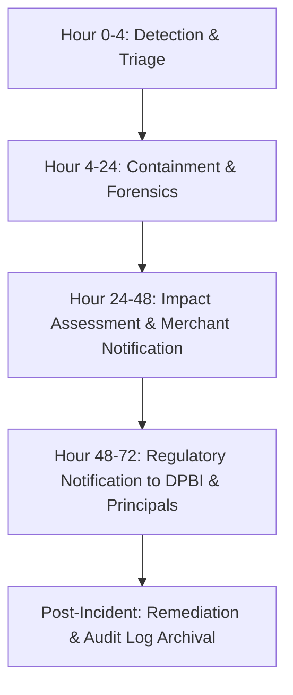

# Metro Cardz — Data Breach Incident Response Plan & Protocol
**Statutory Alignment**: Digital Personal Data Protection Act, 2023 (Section 8(6)) & Information Technology Act, 2000 (Sections 43A, 72, 72A)  
**Document Ref**: MC-SOP-IRP-2024-v1  
**Target Entities**: Metro Cardz Platform Team (Data Processor) & Enrolled Merchants (Data Fiduciaries)  
**Emergency Contact**: `security@metrocardz.in` | `privacy@metrocardz.in`  

---

## 1. Statutory Roles & Regulatory Mandate

Under the **Digital Personal Data Protection Act, 2023 (DPDP Act)**:
1. **The Merchant** is the **Data Fiduciary** for their customers' personal data (name, mobile number, date of birth, transaction history).
2. **Metro Cardz Technologies** is the **Data Processor** operating the digital membership and loyalty platform under a lawful contract (Merchant Data Processing Agreement).
3. **Section 8(6) DPDP Act Mandate**: In the event of a personal data breach, the Data Fiduciary and Data Processor are statutorily required to notify the **Data Protection Board of India (DPBI)** and each affected data principal in the prescribed form and manner.

---

## 2. Severity Classification Matrix

| Level | Severity | Description | Target Containment SLA | Notification SLA |
|-------|----------|-------------|-------------------------|------------------|
| **SEV-1** | **Critical** | Confirmed unauthorized extraction or public exposure of unencrypted PII (phone numbers, member names, or secret salts). | **< 4 Hours** | **< 24h to Merchant** **< 72h to DPBI** |
| **SEV-2** | **High** | Compromised merchant owner or admin credential with unauthorized read access, or brute-force OTP attack bypass. | **< 12 Hours** | **< 24h to Merchant** |
| **SEV-3** | **Medium** | Tampered QR token, isolated CSRF/XSS vulnerability reported, or single anomalous token query without bulk exfiltration. | **< 24 Hours** | Internal log & containment |
| **SEV-4** | **Low** | Scanning/probing attempt successfully blocked by IP rate limiters or security headers. | **< 48 Hours** | Automated audit logging |

---

## 3. Incident Timeline: 24 to 72 Hour Operational Workflow

### Phase 1: Hours 0 – 24 (Detection, Immediate Containment & Isolation)
1. **Immediate Quarantine**:
   - If an API token, secret salt, or credential is suspected of compromise, immediately invalidate active JWT sessions via secret key rotation.
   - For suspected server IP abuse, trigger host firewall blocklist via Hostinger panel or in-memory sliding window IP block (`rateLimitStore`).
2. **Database & Tenant Isolation Audit**:
   - Inspect `PIIAccessLog` (`SELECT * FROM pii_access_log WHERE created_at >= NOW() - INTERVAL 24 HOUR`) to determine exact records accessed.
   - Cross-examine `AdminAuditLog` for rogue actions or unauthorized tenant context queries.
3. **Internal Incident Log Creation**:
   - File incident via `POST /api/v1/compliance/incident` with severity, scope, and initial containment actions taken.

### Phase 2: Hours 24 – 48 (Impact Assessment & Data Fiduciary Alert)
1. **Scope Determination**:
   - Calculate exact count of affected data principals (members) and affected merchants.
   - Categorize whether encrypted fields were involved or unencrypted fields.
2. **Notification to Merchant (Data Fiduciary)**:
   - Metro Cardz transmits formal Incident Briefing to Merchant Owner's registered email and WhatsApp:
     - Date and approximate time of incident
     - Nature of data involved
     - Containment steps already completed
     - Remediation guidance for merchant counter staff

### Phase 3: Hours 48 – 72 (Statutory Notification to DPBI & Data Principals)
1. **Formal Filing to Data Protection Board of India (DPBI)**:
   - Provide statutory notice in accordance with DPDP Section 8(6) containing:
     - Nature, cause, and extent of the personal data breach
     - Categories and approximate number of data principals affected
     - Likely consequences and impact assessment
     - Mitigation and remediation measures taken by Data Processor & Fiduciary
     - Name and contact details of the Grievance Officer
2. **Notification to Affected Members**:
   - Plain-language notification via verified SMS/WhatsApp channel informing them of the event, steps taken to secure their pass, and assurance that payment/banking credentials were not held or exposed.

---

## 4. Key Security Controls in Production Codebase

1. **Cryptographic Protection (IT Act Section 43A)**:
   - Sensitive PII fields encrypted with **AES-256-GCM** using authenticated 96-bit IVs (`app/src/lib/security.ts`).
   - QR member tokens derived via **HMAC-SHA256** using per-merchant random `secretSalt` — tokens cannot be sequentially guessed or forged.
2. **Strict Multi-Tenant Isolation**:
   - Query filters enforced server-side via `getMerchantId(auth, request)`. Tenant spoofing via client headers is rejected for non-super-admin sessions.
3. **Immutable Audit Trails**:
   - `member_consents`: Append-only consent ledger (DPDP Section 6).
   - `pii_access_log`: Immutable log of every decrypted PII access (DPDP Section 8).
   - `admin_audit_log`: System, DPA acceptance, and incident trail.
4. **Data Portability & Erasure**:
   - `/api/v1/dpdp/export`: Right to access and download personal data (Section 11).
   - `/api/v1/dpdp/correction`: Right to correct inaccurate records (Section 12).
   - `/api/v1/dpdp/erasure`: Anonymisation of customer PII on demand (Section 13).

---

## 5. Incident Response Team & Grievance Contact

- **Data Grievance Officer**: Data Privacy Officer, Metro Cardz Technologies  
- **Email**: `privacy@metrocardz.in` | `dpdp@metrocardz.in`  
- **Technical Incident Hotline**: `security@metrocardz.in`  
- **Statutory Review Interval**: Bi-annually or upon any update to DPDP Act rules
